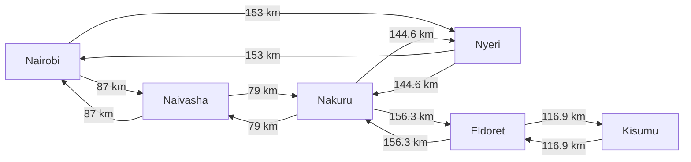
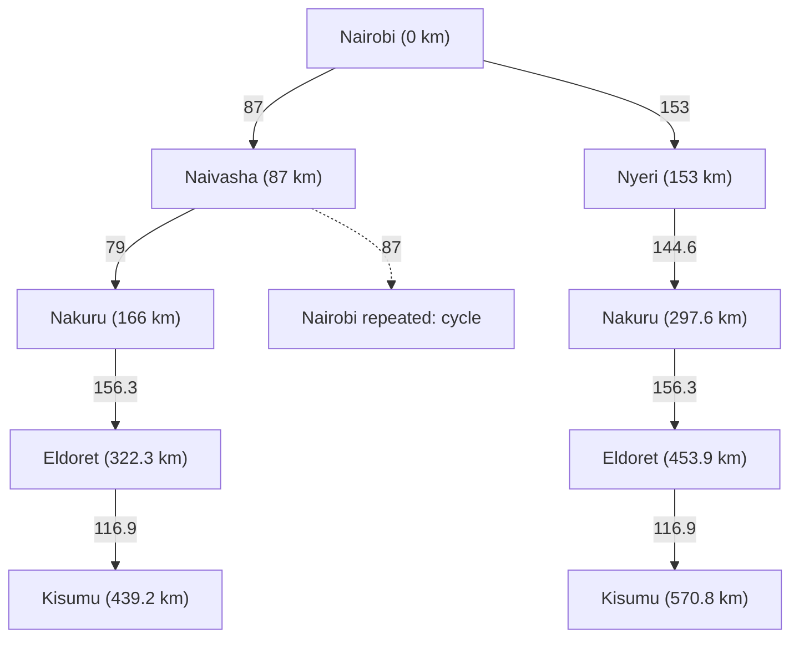

# ICS 3202: Artificial Intelligence
## Practical Exercise 3: Designing a Searching Agent

### 1. Introduction

This exercise designs an intelligent agent for a self-driving trailer and models a high-level journey from Nairobi to Kisumu. It applies PEAS and task-environment classifications, then represents selected Kenyan towns as a weighted road graph and compares routes using Uniform-Cost Search (UCS). The graph is a teaching model of selected highway connections; it is not a complete national road map.

The assignment handout/class map was not present in the supplied workspace. The network below is therefore a proposed representation for later comparison with the lecturer's map. Mapping distance sources are secondary route planners, not a live Google Maps measurement. Distances are rounded to the precision reported by those sources and can change with endpoints and route choice.

### 2. Question One: Agent Design

#### 2.1 Problem Definition

The agent perceives the trailer, its surroundings, road conditions, and its current route, and selects actions to transport its load safely and lawfully. At the strategic level it chooses a route; at the tactical and control levels it maintains safe motion in changing traffic. An agent is the system that maps percepts to actions; the road, traffic, weather, trailer, and other road users form its environment.

#### 2.2 PEAS Framework

| Element | Design for a self-driving trailer on Kenyan highways |
|---|---|
| **Performance measure** | Minimise collision and injury risk; obey traffic rules and speed limits; deliver the load to the correct destination; avoid damage to the trailer, cargo, and road infrastructure; manage fuel/energy and travel time; maintain stability, braking distance, and safe following distance. Safety and legal compliance are hard constraints rather than benefits that may be traded away for small time savings. |
| **Environment** | Kenyan highways and connecting roads, including paved and possibly degraded surfaces, lanes, junctions, roadworks, shoulders, toll/inspection points, and settlements; weather, visibility, terrain, signs, markings, pedestrians, animals, bicycles, motorcycles, cars, buses, trucks, and emergency responders. The physical environment changes over time and may include incomplete or outdated map data. |
| **Actuators** | Steering, throttle/traction, service and emergency braking, transmission, indicators, lights, horn, wipers, trailer braking/stability controls, and communications/display systems used to signal or request assistance. Route selection is a high-level action; steering and braking are low-level control actions. |
| **Sensors** | Cameras; radar and/or lidar; GNSS/GPS; inertial and wheel-speed sensors; trailer hitch/load and brake sensors; engine/battery diagnostics; digital maps; road-sign recognition; and, where available, traffic/weather feeds and vehicle-to-infrastructure communications. Sensor fusion estimates location, speed, lane position, obstacles, road geometry, and the state of the trailer. |

#### 2.3 Task Environment Classification

The classification below describes **physical autonomous driving**, not the simplified map-search subproblem. Classification can change with the modeling assumptions.

| Dimension | Classification | Reason in this scenario |
|---|---|---|
| Observability | Partially observable | Sensors have finite range and can be obscured by rain, dust, darkness, glare, large vehicles, or road geometry. The agent cannot directly observe every other driver's intentions or hidden road hazards. It must maintain an estimate of the world from percept history. |
| Determinism | Stochastic | Other road users, weather, surface conditions, mechanical behavior, and sensor noise make action outcomes uncertain. A commanded braking action does not guarantee one exact stopping distance under all loads and road conditions. |
| Episodicity | Sequential | Each action changes the state and affects later choices. Speed, lane position, trailer sway, following distance, and route choices have consequences over time. |
| Dynamics | Dynamic | Traffic and hazards can change while the agent is sensing and deciding. The physical environment does not remain fixed during deliberation. |
| State/action space | Continuous (with discrete elements) | Position, speed, steering angle, and distances vary continuously. Lane changes, signs, road junctions, and route choices are discrete events. |

#### 2.4 Assumptions and Limitations

At the physical level, the agent is **multi-agent** because other drivers, pedestrians, and animals act in the same environment; this is an additional classification, not one of the five dimensions above. The environment is partly **unknown** because the agent may not know the precise behavior of other road users, current road condition, or sensor error in advance. It can use learned models and map data while updating its estimates.

At the abstract route-planning level used in Questions 2 and 3, a state is only a town name, the available road links and their weights are assumed known, and the map is fixed. Under those assumptions the planning problem is fully observable and deterministic, sequential, static, and discrete. The real driving task remains partially observable, stochastic, sequential, dynamic, and mixed/continuous. A town-to-town route does not solve the trailer's low-level driving or safety problem.

### 3. Question Two: Graph and Search Tree

#### 3.1 Selection of Towns and Regions

The selected nodes are Nairobi (origin), Nyeri (Central Highlands alternative), Naivasha and Nakuru (Rift Valley corridor), Eldoret (western corridor), and Kisumu (Lake Victoria Basin destination). Nyeri creates a geographically plausible alternative branch; the direct Nairobi–Naivasha–Nakuru corridor gives the other principal choice. The selected set is intentionally small enough to display and does not include every road, bypass, or intermediate settlement.

#### 3.2 Road Connectivity and Distance Data

Distances below are **road distances reported by the cited route sources**, accessed 16 October 2026. They are not straight-line distances. A Google Maps directions link is provided for each pair so the group can compare the selected route and exact town-centre endpoints against Google Maps before submission. Search results and route planners can use different endpoints or routing assumptions; values are therefore estimates for this model rather than survey measurements. The reverse-direction edge is assigned the same weight for graph simplicity; this is an explicit approximation, since one-way systems or route selection can produce asymmetric distances.

| From | To | Road distance (km) | Distance source | Google Maps route check |
|---|---|---:|---|---|
| Nairobi | Naivasha | 87 | [Rome2Rio driving distance](https://www.rome2rio.com/s/Nairobi/Naivasha) | [Directions](https://www.google.com/maps/dir/Nairobi,+Kenya/Naivasha,+Kenya/) |
| Naivasha | Nakuru | 79 | [FromToDistance driving distance](https://fromtodistance.com/naivasha-to-nakuru/) | [Directions](https://www.google.com/maps/dir/Naivasha,+Kenya/Nakuru,+Kenya/) |
| Nairobi | Nyeri | 153 | [Travelmath driving distance](https://www.travelmath.com/drive-distance/from/Nairobi%2C%2BKenya/to/Nyeri%2C%2BKenya) | [Directions](https://www.google.com/maps/dir/Nairobi,+Kenya/Nyeri,+Kenya/) |
| Nyeri | Nakuru | 144.6 | [VeryMap route distance, based on OpenStreetMap/GraphHopper](https://verymap.net/distances/182701-184622/nyeri/nakuru/) | [Directions](https://www.google.com/maps/dir/Nyeri,+Kenya/Nakuru,+Kenya/) |
| Nakuru | Eldoret | 156.3 | [Rome2Rio driving distance](https://www.rome2rio.com/s/Nakuru/Eldoret) | [Directions](https://www.google.com/maps/dir/Nakuru,+Kenya/Eldoret,+Kenya/) |
| Eldoret | Kisumu | 116.9 | [DistanceCalculator.net driving distance](https://www.distancecalculator.net/from-eldoret-to-kisumu) | [Directions](https://www.google.com/maps/dir/Eldoret,+Kenya/Kisumu,+Kenya/) |

The connecting corridors are also supported by road-network descriptions: the Nairobi–Naivasha–Nakuru–Eldoret route lies along the A104 corridor, and official Eldoret planning material identifies the Eldoret–Kisumu B8 corridor ([City of Eldoret Integrated Development Plan](https://eldoretcity.go.ke/wp-content/uploads/2026/03/CoE-IDeP-2026.pdf)). The Nyeri–Nakuru connection is a plausible regional-road route and its distance is from the cited router. The assignment group should verify current directions and exact endpoints in Google Maps; the supplied class map was unavailable.

#### 3.3 Directed Weighted Graph

The network is modeled as bidirectional where represented: each physical connection is encoded as two directed edges with equal weights. This symmetric-weight convention is an abstraction, not a claim that every navigation service returns identical reverse routes. Each diagram label matches the distance table.

*Figure 1. Proposed directed representation of selected highway connections. Arrow labels are modeled road distances in kilometres.*

#### 3.4 State-Space Representation and Abstraction

The real driving task is simplified into a symbolic state-space problem:

- **State:** the town currently occupied (for example, `Nakuru`).
- **Initial state:** `Nairobi`.
- **Actions:** travel along one outgoing road edge to an adjacent modeled town.
- **Transition model:** taking edge ((u,v)) changes the state from town (u) to town (v).
- **Goal test:** the current town is `Kisumu`.
- **Step cost:** the road distance attached to that edge, in kilometres.
- **Path cost:** sum of step costs from Nairobi to the current state.

This abstraction omits steering, braking, lane position, exact coordinates, intermediate junctions, traffic, stops, trailer dynamics, and road condition. Those details matter to safe physical driving but are outside the high-level shortest-distance calculation. The underlying graph may contain cycles because its road links are bidirectional; for example, Nairobi → Naivasha → Nairobi repeats Nairobi. A search tree can therefore contain repeated states unless the search algorithm checks its explored/frontier sets.

#### 3.5 Search Tree

The following is a **conceptual path tree** that displays the two principal simple routes represented by the graph. Costs in parentheses are cumulative from Nairobi. It is not claimed to be the expansion order of UCS or a complete enumeration of every cyclic walk. A repeated-state branch is shown as a cycle and is not expanded further.

*Figure 2. Conceptual tree of the two simple Nairobi–Kisumu routes in the model; edge labels are step costs in kilometres.*

#### 3.6 Search Strategy

The graph is weighted, and edge costs are non-negative distances. UCS is therefore appropriate: it repeatedly removes the lowest cumulative-cost path from the frontier, rather than choosing the next town by geographic appearance or by the first route discovered. Dijkstra's algorithm is the graph-search form of this idea. With a best-known-cost table and stale/longer frontier entries ignored, a state is finalized when removed at minimum cost. A goal may safely be accepted when it is removed from the priority queue, not merely when first generated.

### 4. Question Three: Optimal Route

#### 4.1 Path Cost Function

For a path (p=(v_0,v_1,ldots,v_n)), define its cost as

\[
g(p)=\sum_{i=0}^{n-1} d(v_i,v_{i+1}),
\]

where (d(u,v)) is the modeled road distance in kilometres on the directed edge from (u) to (v). The objective is to minimize (g(p)) among paths in this graph from Nairobi to Kisumu.

#### 4.2 Candidate Route Calculations

**Route A — via Naivasha and Nakuru**

\[
87 + 79 + 156.3 + 116.9 = 439.2\text{ km}
\]

| Leg | Step cost (km) | Cumulative (km) |
|---|---:|---:|
| Nairobi → Naivasha | 87 | 87 |
| Naivasha → Nakuru | 79 | 166 |
| Nakuru → Eldoret | 156.3 | 322.3 |
| Eldoret → Kisumu | 116.9 | **439.2** |

**Route B — via Nyeri and Nakuru**

\[
153 + 144.6 + 156.3 + 116.9 = 570.8\text{ km}
\]

| Leg | Step cost (km) | Cumulative (km) |
|---|---:|---:|
| Nairobi → Nyeri | 153 | 153 |
| Nyeri → Nakuru | 144.6 | 297.6 |
| Nakuru → Eldoret | 156.3 | 453.9 |
| Eldoret → Kisumu | 116.9 | **570.8** |

#### 4.3 Uniform-Cost Search or Dijkstra's Algorithm

The initial state is Nairobi and the goal state is Kisumu. UCS stores candidate paths in a priority queue ordered by cumulative distance (g). It expands the least-cost path available, relaxes each outgoing edge, and updates a town's best-known cost when a cheaper path is found. More expensive arrivals at an already reached town are ignored; cycles do not improve a path because all modeled edge weights are positive. The algorithm terminates once Kisumu is removed from the frontier at its least cost.

#### 4.4 Search Execution and Cumulative Costs

The table shows the principal cost improvements relevant to the goal. Within each displayed group, the lower-cost frontier item is considered first. The precise order of equal-cost unrelated frontier states does not affect the result.

| Frontier path ending at | Cumulative cost (km) | Decision |
|---|---:|---|
| Naivasha via Nairobi | 87 | Expand; generate Nakuru at 166 km. |
| Nyeri via Nairobi | 153 | Expand; generate Nakuru at 297.6 km. |
| Nakuru via Naivasha | 166 | Expand; generate Eldoret at 322.3 km. |
| Nakuru via Nyeri | 297.6 | Discard as a more expensive arrival at Nakuru (best is 166 km). |
| Eldoret via Naivasha, Nakuru | 322.3 | Expand; generate Kisumu at 439.2 km. |
| Kisumu via Eldoret | 439.2 | Remove at minimum cost; goal reached and search can terminate. |

Other towns may be generated by reverse edges, but the best-cost/explored check prevents repeated states from causing endless cycling. The lower-cost arrival at a state dominates a higher-cost arrival because the modeled future options and edge costs depend only on the current town.

#### 4.5 Optimal Route and Total Distance

Within this modeled graph and its recorded edge weights, the minimum-distance route is:

**Nairobi → Naivasha → Nakuru → Eldoret → Kisumu**, with total modeled road distance **439.2 km**.

It is 131.6 km shorter than the modeled alternative via Nyeri (570.8 km). This is an optimum only for the selected graph and recorded weights, not a claim about every possible road route in Kenya.

#### 4.6 Verification and Limitations

The arithmetic was checked by summing the listed edge weights: (87+79+156.3+116.9=439.2) km and (153+144.6+156.3+116.9=570.8) km. The modeled graph has six undirected town connections represented by twelve directed edges; each reverse edge uses the same assumed weight. Search output is consistent with the candidate-route totals.

The distances are point-to-point estimates from route-planning websites, accessed 16 October 2026, and Google Maps links are supplied for the group to verify. Starting/ending points, routing options, road works, and map updates may change the measurements. The map omits other possible connections and intermediate towns, so the calculated optimum is not a national-network optimum. The route distances are not travel times and do not model traffic, safety, tolls, fuel use, trailer restrictions, or weather. Before submission, the group should record a consistent Google Maps measurement for each edge (including reverse directions if unequal) and update every matching table, graph, tree, and calculation value.

### 5. Groupwork Evidence

**Evidence not supplied in the workspace.** Replace this placeholder with genuine group information before submission.

| Evidence required | Status / action |
|---|---|
| Group member names and roles | Not supplied. Add names and each member's actual contribution; do not infer participation. |
| Meeting minutes or collaboration record | Not supplied. Add actual meeting dates, decisions, and attendees if the group has them. |
| Team photograph | Not supplied. If required by the lecturer, add the real image to the repository and embed it here using a relative Markdown path. |
| Lecturer's map or class notes | Not supplied. Compare this proposed graph with the class material and cite it only after receiving it. |

Each group member should follow the lecturer's required GitHub fork workflow. The owner of the original repository should submit the original repository URL through e-learning. Do not report a fork, contribution, or submission until it has occurred.

### 6. Conclusion

The PEAS design separates the trailer's safety-focused physical driving task from high-level route planning. In the symbolic model, towns are states and road distances are non-negative transition costs. UCS selects the Nairobi–Naivasha–Nakuru–Eldoret–Kisumu path at 439.2 km as the minimum-distance route within the proposed graph. The result depends on a simplified network and provisional route-source measurements; comparison with the lecturer's map and consistent Google Maps checks should precede final submission.

### 7. References

All web sources below were accessed 16 October 2026.

1. Rome2Rio. “Nairobi to Naivasha.” [https://www.rome2rio.com/s/Nairobi/Naivasha](https://www.rome2rio.com/s/Nairobi/Naivasha).
2. FromToDistance. “Naivasha to Nakuru.” [https://fromtodistance.com/naivasha-to-nakuru/](https://fromtodistance.com/naivasha-to-nakuru/).
3. Travelmath. “Driving distance from Nairobi, Kenya to Nyeri, Kenya.” [https://www.travelmath.com/drive-distance/from/Nairobi%2C%2BKenya/to/Nyeri%2C%2BKenya](https://www.travelmath.com/drive-distance/from/Nairobi%2C%2BKenya/to/Nyeri%2C%2BKenya).
4. VeryMap. “Nyeri to Nakuru,” route based on OpenStreetMap data and GraphHopper. [https://verymap.net/distances/182701-184622/nyeri/nakuru/](https://verymap.net/distances/182701-184622/nyeri/nakuru/).
5. Rome2Rio. “Nakuru to Eldoret.” [https://www.rome2rio.com/s/Nakuru/Eldoret](https://www.rome2rio.com/s/Nakuru/Eldoret).
6. DistanceCalculator.net. “Eldoret to Kisumu.” [https://www.distancecalculator.net/from-eldoret-to-kisumu](https://www.distancecalculator.net/from-eldoret-to-kisumu).
7. City of Eldoret. *County Integrated Development Plan 2026*, road-corridor description. [https://eldoretcity.go.ke/wp-content/uploads/2026/03/CoE-IDeP-2026.pdf](https://eldoretcity.go.ke/wp-content/uploads/2026/03/CoE-IDeP-2026.pdf).
8. Google Maps directions links are included in Section 3.2 for verification; the routes and distances shown by those interactive pages were not independently inspected for this draft.
